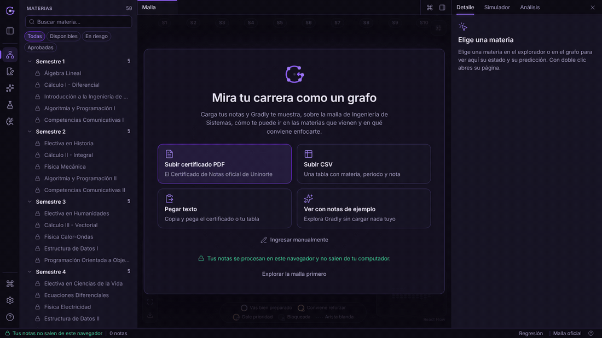

<p align="center">
  
</p>

<p align="center">
  
  
  
  
  
  
  
</p>

<p align="center">
  Predictor de rendimiento académico sobre la malla curricular.<br>
  Carga tus notas y mira cómo te puede ir en las materias que vienen y en cuáles enfocarte.
</p>

<p align="center">
  <a href="https://gradly-delta.vercel.app"><strong>Probar Gradly en línea →</strong></a>
</p>

- **La malla como grafo.** 50 materias y sus prerrequisitos de Ingeniería de Sistemas, en un grafo dirigido acíclico.
- **Predicción por materia.** Nota esperada, rango y semáforo de riesgo, con las materias previas que más pesan.
- **Qué repasar.** Prioriza por centralidad en el grafo y señala los temas puntuales a reforzar.
- **Privado.** Las notas se procesan en el navegador y no salen del computador.

<p align="center">
  
</p>

## Instalación y uso

Requisitos: Node 20+ y Python 3.11+.

**Web**

```bash
cd web
npm install
npm run dev          # http://localhost:5173
npm test
```

Entra con el certificado PDF de Uninorte, un CSV (`materia,periodo,nota`), texto pegado o las notas de ejemplo.

**Modelo**

```bash
python -m venv .venv
source .venv/bin/activate                 # Windows: .venv\Scripts\activate
pip install -r model/requirements.txt -r api/requirements.txt

cd model
python -m gradly_model.train              # entrena y exporta data/pesos.json
python -m gradly_model.train --notas notas.csv
python -m gradly_model.experimentos       # reporte y figuras en docs/modelo/
pytest
```

**API (opcional)**

```bash
cd api
uvicorn app.main:app --reload             # http://localhost:8000/docs
pytest
```

Variables en [`api/.env.example`](api/.env.example). Sin `DATABASE_URL` usa SQLite.

## Más información

### Estructura

```
web/     App: React, TypeScript, Vite y React Flow
model/   Simulación, entrenamiento y validación (Python, NumPy)
api/     Donación anónima de notas (FastAPI, Postgres)
data/    Malla, plantilla de notas, pesos del modelo y esquemas
docs/    Plan, decisiones del modelo, informe y diapositivas
```

### Modelo

Una regresión por materia sobre sus ancestros en la malla, con penalización que crece con la distancia en el grafo:

```
ŷ = μ + b + β·a + Σ w·z
```

`μ` es la media de la materia, `a` el nivel del estudiante y `z` cómo le fue en cada materia previa frente a su nivel. También hay una red neuronal escrita en NumPy; en la app se puede alternar entre las dos.

| | Error medio (puntos de nota) |
| --- | --- |
| Promedio del estudiante | 0,457 |
| Red neuronal | 0,303 |
| **Regresión sobre la malla** | **0,294** |

Validación cruzada por estudiante con 300 estudiantes simulados sobre la malla oficial. Detalles en [`docs/modelo/DECISIONES.md`](docs/modelo/DECISIONES.md) y [`docs/modelo/reporte.md`](docs/modelo/reporte.md).

### Datos

| Archivo | Contenido |
| --- | --- |
| [`data/malla_sistemas.json`](data/malla_sistemas.json) | Malla oficial: materias, prerrequisitos, aristas blandas y contenidos cruzados |
| [`data/malla_ejemplo.json`](data/malla_ejemplo.json) | Malla pequeña de 16 materias para las pruebas |
| [`data/plantilla_notas.csv`](data/plantilla_notas.csv) | Formato de notas: `materia,periodo,nota` |
| [`data/pesos.json`](data/pesos.json) | Pesos del modelo que usa la web |

### Pruebas

Cada parte tiene casos con resultado conocido: un grafo resuelto a mano, una predicción calculada a mano que Python y TypeScript deben reproducir, la recuperación de pesos simulados y la retropropagación contra la derivada numérica. La web suma pruebas de punta a punta y de accesibilidad con Playwright (`npm run test:e2e`).

### Despliegue

La web está publicada en Vercel: [gradly-delta.vercel.app](https://gradly-delta.vercel.app). Es un sitio estático; la predicción corre en el navegador y no necesita la API.

[`vercel.json`](vercel.json) construye desde `web/` y publica `web/dist`. Se despliega desde la raíz del repo porque la web importa la malla y los pesos de `data/`; [`.vercelignore`](.vercelignore) deja por fuera `api/`, `model/` y `docs/`.

```bash
npx vercel deploy --prod
```

La API (opcional) se despliega aparte con [`api/Dockerfile`](api/Dockerfile) y Postgres; ver [`api/README.md`](api/README.md).

### Equipo

| | Frente |
| --- | --- |
| [Carlos Del Castillo](https://github.com/krl0sconk) | Modelo |
| [Maikel Ortiz](https://github.com/MaikelO11) | Web |
| [Joel Trespalacios](https://github.com/ImGTrK) | API |
| [Samuel Pabuena](https://github.com/samuelpabuena2008) | Base del repositorio y grafos |
| [Rafael Sierra](https://github.com/rafaelcodesx) | Informe |

Proyecto final de Matemáticas Discretas (MAT 4021), Universidad del Norte, 2026. Profesor Iván Gómez.

### Contribuir

Trabaja en una rama, corre las pruebas de la parte que tocaste y abre un pull request contra `main`.

### Licencia

Todavía sin licencia definida.
